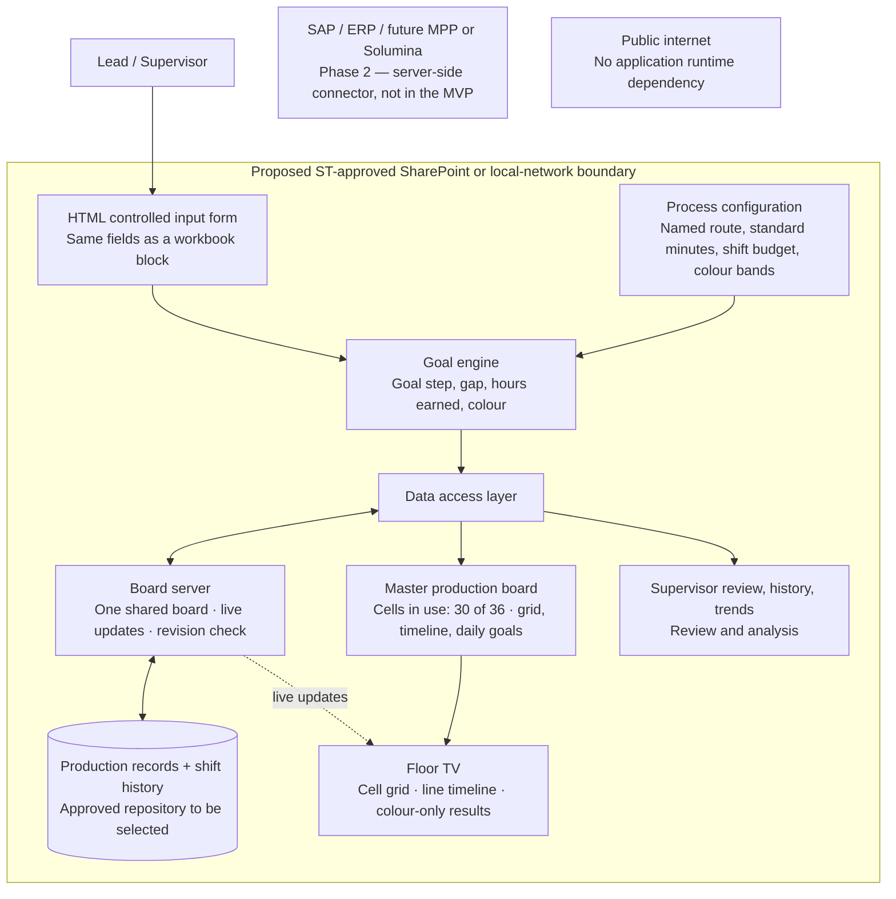

# Current architecture hypothesis — subject to stakeholder validation

This is a working demonstration of the application's modules and information flow. It does not claim that ST has approved a deployment environment, security controls, time standards, or workforce reporting rules.

## Four modules and their current implementation

| Module | Current implementation | Validation or future work |
| --- | --- | --- |
| Data input | Board-shaped form: Name(s), Job #, Hand, Part, Start, Goal (calculated), Stop, Comment. Start and stop are chosen by step name; cell, date, and shift come from the clicked cell; overtime is in hours; duplicate assignments are rejected | The client's simplified intake design, approved names, cell roster, shift conventions, and permitted operator visibility |
| Goal engine | `dist/engine.js`, a pure module: nearest-step and whole-step goal rules, hours earned, colour bands, and completion by standard hours | Approved routes and standards, TAC definition, meaning of purple, breaks, partial work, parallel operations, rework, and final acceptance |
| Production board | HTML/CSS/JS: weekly grid of the cells in use (30 of 36) with click-to-assign, line timeline, daily goal cards, TV cell grid / timeline / goals table, and supervisor review | TV resolution and distance, cells per screen and rotation (floor lead), secure floor device, real role permissions |
| History / analytics | `server/server.js` + `dist/sync.js` shared board with live updates, or `dist/storage.js` device-local adapter when opened as a file; history snapshots with step names, hours, and colour; route revisions; CSV | Shared storage, identity, concurrency, append-only audit controls, backups, retention, and network deployment |

The interactive **Architecture** page mirrors these modules and makes implemented behavior distinguishable from proposed infrastructure.

## Goal calculation

All step names and timings are fictional until approved standard work is supplied.

1. A route is an ordered list of named steps with standard minutes. Zero-minute steps are checkpoints, for example "Notify lead: ready for cure".
2. `start` is stored as the number of steps already complete. The form shows it as the first step worked this shift (**Start**); `end` is the last step completed (**Stop**).
3. Budget = the process's shift budget (8 standard hours by default) + overtime hours × 60. A rate multiplier divides every step duration.
4. **Nearest-step rule** (default; matches the workbook): the goal is the step whose cumulative standard time is closest to start + budget, with ties going to the earlier step. The goal can sit slightly above or below the budget.
5. **Whole-step rule** (v3): the goal is the last step that fits entirely inside the budget.
6. Gap = stop − goal, in steps. Hours earned = standard time from start to stop.
7. Completion = standard hours complete ÷ the route's total standard hours. It reaches 100% only when the final step is recorded.

Example with the sample inner-bondment route: start on step 5, "Peel & prep skin", with an 8-hour budget and the goal is step 13, "3rd debulk". With 1 overtime hour it becomes step 14, "Lay up ply level 6". Stopping at step 13 earns 8.0 standard hours: a gap of −1 and a yellow shift against the 9-hour budget.

A timing rate of 1 uses standard durations; a rate of 2 halves them. The demo does not infer personal performance or adjust rates by employee.

## Shift colours

Finished shifts are coloured by hours earned against their own budget. The defaults reproduce the workbook's conditional formatting on an 8-hour shift:

| Colour | Hours earned on an 8 h shift | Relative to the budget |
| --- | --- | --- |
| Red | below 6.5 | more than 1.5 h below |
| Yellow | 6.5 – 7.5 | 0.5 – 1.5 h below |
| Green | 7.5 – 8.05 | from 0.5 h below to 0.05 h above |
| Purple | 8.05 or more | 0.05 h or more above |

Overtime raises every band by the overtime hours. Open shifts are not coloured, because a partial shift is not evidence of lateness. Training shifts and shifts reported as blocked are never coloured. The workbook leaves 6.49–6.5 h uncoloured; the app treats it as red. The margins are editable per process and saved with each revision.

## Status semantics

- **In progress / At risk / Blocked:** an open shift; at risk and blocked are reported on the form.
- **Goal met:** an open shift that has already reached its goal step.
- **Red / Yellow / Green / Purple:** a finished shift's colour, shown with its hours earned.
- **Training:** never coloured. A finished shift reported as **Blocked** stays blocked and is not coloured.
- **No full step planned:** the budget could not reach another step.
- **Below target:** a finished shift below its goal that has no budget to colour against.

## Supervisor review

The review page counts colours per operator for finished, coloured shifts over 1, 2, or 4 weeks, across all processes, cells, and shifts. A shared shift counts once for each named operator. Operators with repeated purples or reds (2, 3, or 4 or more) are flagged, and every purple shift links to its job history. Averages compare hours earned with each shift's own budget. The page carries no login and says so; the meaning of purple and the permitted comparisons remain stakeholder decisions.

## Data model

Production assignments contain an ID, assignment date, shift, operator names, work cell, process ID, job ID, part (the route name), hand (LH/RH), start, goal, stop, total steps, shift budget, overtime minutes, goal rule, reported status, finished and training flags, comments, previous-assignment link, and update timestamp.

Each assignment keeps its step timings and route revision. Every saved process revision is stored with its step names, timings, budget, goal rule, and colour bands, so renaming steps, importing a route, or restoring the standard route never renames or recalculates older records. Each history event copies the assignment together with its start, stop, and goal step names, hours earned, and colour.

Every date/shift assignment has its own ID and operator record. Next shift creates a new assignment linked by previousAssignmentId, prefilled from the prior stop. Prior assignments are retained. Production-day order provisionally follows the workbook: 3 → 1 → 2, then the next date. Earlier corrections do not automatically rewrite downstream assignments.

The weekly assembly view selects the latest assignment per process/job through the chosen day, before grouping by cell. Multiple shifts do not inflate assembly totals. A unit stays in its last-recorded cell until a later assignment moves it, and leaves the grid after the day it reaches its final step; this is not verified live occupancy. Days after today show as upcoming. Cell 01–36 are placeholders; Floor display sets how many are in use (30 by default), and a later cell stays visible while it holds a unit. A job number is provisionally one unit within a process.

Overtime entry is in hours, storage stays in minutes, and the shift budget lives in process configuration. A handoff keeps the unit's route revision and takes the current default shift budget.

## Storage and deployment boundary

The prototype runs from a local file, a static HTTP server, or the board server in `server/`. All runtime assets are bundled locally. It does not load fonts, libraries, analytics, or data from the internet, and does not call SAP, MPP, SharePoint, or any external API.

Opened as a file or from a static server, the replaceable storage adapter uses the browser's local storage under `quest-board-demo-v6`. It is persistent on that browser/origin when storage is available, but it is neither secure shared enterprise storage nor a tamper-proof audit service. Separate devices do not share data. Same-origin tabs receive updates through storage events. Concurrent writers are last-write-wins in this demo. Local edits from v5 and earlier remain in the browser under their old keys and are not loaded.

Served by the board server, every screen uses one board; see *v7: shared board server* below. The target deployment hypothesis is an ST-approved SharePoint or local-network environment with an approved shared data source. SharePoint/OneDrive, Excel, local files, and an internal service remain candidates, not validated choices. A browser cannot safely be assumed to update a shared Excel workbook just because the file lives on a network share. Write access, authentication, locking, validation, and deployment feasibility require an approved integration design.

No external publication is part of this local demonstration.

## Cross-cutting constraints to validate

- Union/workforce rules: permitted operator data, identity visibility, comparisons, and retention.
- GCC High / FedRAMP: applicability, permitted environment, and approved controls to be established with ST IT. This demo makes no compliance claim.
- Proprietary manufacturing data: fictional routes until an approved internal path is agreed. A pasted route stays in the local browser.
- Simplicity: the entry form matches the workbook block; minimal operator/TV display; no editable spreadsheet layout.
- Robustness: dropdowns instead of free text, calculated fields, validation, recoverable errors, and historical snapshots.
- Scalability: routes are data; goal calculations and data access are separate modules.

## Decisions needed for an ST pilot

1. Approved routes (step names and standard minutes) for each part, the shift budget, overtime rules, and what TAC means in this workflow.
2. The goal rule (keep the workbook's nearest-step lookup or use whole steps) and the Start convention; see `MEETING FOLLOW-UP.md`.
3. What purple means, whether repeats should be flagged, and which operator comparisons are permitted.
4. Whether work is sequential, partially complete, parallel, or subject to rework; the definition of unit completion and acceptance.
5. ST-approved host, data source, read/write identity, access boundaries, and device setup.
6. Concurrency, audit retention, backup/recovery, and shift rollover behavior.
7. Actual TV size/resolution and a supervisor usability review.

## Meeting and workbook reconciliation

See `MEETING FOLLOW-UP.md` for the 9/28 feedback, the reviewed workbook ranges, and the open decisions. The app has no automatic quality judgements, rankings by score, or enforced supervisor access; flags are prompts for review.

## v6 hours: Operations, the person, and the unit

Operations sets the standard day (8 h, 40 h a week); a person's day is that plus any overtime the lead enters on their assignments, with no approval step → the job form takes the regular hours the named people have left that day, plus additional hours, minus waiting → the goal engine computes the goal from those hours to build → the lead records the stop, the waiting reason, and a comment → Operator day, Insights, unit history, TV, and CSV read the same records.

An assignment's hours worked = regular + additional; hours to build = hours worked − waiting. Waiting counts toward the person's day but not toward building, so goals and colours never hold it against the operator, while the unit and station still show it. Everyone named on an assignment shares its hours. Hours booked for a person = hours worked on their assignments that day plus training-center and other off-unit time, entered by the lead when it happens. Hours left = the person's day − hours booked, across every cell and shift. A shared assignment is limited by whoever has the least time left; the names are not added together.

Two separate views, never combined into one score:

| Question | View | Measure |
| --- | --- | --- |
| Did each person's day add up? | Insights → People; Operator day | The day (standard + additional) vs. building, waiting, training, and not booked, across all cells |
| Was a day with additional hours full of work? | Insights → People → Worked additional hours | Each day over 8 h, with the hours to build and the standard hours earned on that person's assignments |
| Where does a unit lose time, and why? | Insights → Units; unit history | Time-study hours earned vs. hours to build, plus waiting by reason; each assignment counts once |
| Which causes matter most? | Insights → Why units wait · 80/20 | Waiting hours by reason, the reasons that reach 80% highlighted |

Station alerts (`stationAlerts` in `dist/production.js`) read the latest assignment of each unit in each cell for the selected day. Alerts follow the process: Blocked is critical; At risk (open shift) is a warning; process efficiency (1 − waiting ÷ total hours) below 90% is a warning and below 75% critical; a run of behind assignments at the same station (2 by default) escalates to critical. Whether the operator met the goal is a person question, shown as the person grade (standard hours completed ÷ (total hours − waiting)) on Supervisor review, Operator day, cards, and Insights, not as a station alert. An acknowledgement is keyed to the assignment and its last update, so a changed record alerts again. The bell, the alerts page, the weekly grid, and both TV layouts read the same list. Rules and acknowledgements are stored with the board state.

Each assignment stores regular minutes (`productiveMinutes`), additional minutes (`overtimeMinutes`), waiting minutes and reason (`delayMinutes`, `delayReason`), and the goal computed from the hours to build. State carries `operations` (standard day, work days) and `offUnit` (person, date, minutes, reason).

Corrections append before/after snapshots. Renaming keeps a stable unit identity across assignments. Removal sets a recoverable deletion marker; active views and hour calculations exclude removed records, while history keeps their events. Restoration checks identity/shift/progress conflicts. These are local safeguards, not an enterprise audit or concurrent-editing system.

## v7: floor display and line timeline (10/15)

`state.display` holds the floor display settings that every screen shares: `cellCount` (cells in use, 30 by default, 1–36), `perScreen` (`all`, 18, 12, or 6 TV cells per screen), `rotateSeconds` (10–60), and `floorNumbers` (false = colour only). `QuestProduction.displaySettings` validates them, and `cellsInUse` returns the cells in use plus any later cell that still holds a unit.

With `floorNumbers` off, the board cards and the TV operator-goals table show the finished shift's colour (`ratingOf`) without the person grade, hours earned, gap, or attainment. The lead and supervisor pages are unchanged. This is a display rule, not access control.

The TV cell grid lists each cell in use, in rows of six. A cell is *active* when its latest unit record is on the selected day, *idle* when it holds a unit last worked on an earlier day, and *open* when it holds none. With `perScreen = all`, the grid is sized to the space left on the screen, and each tile's text is sized from the tile's own height (CSS container queries), so 6 or 36 tiles both read from a distance; short tiles drop the step line first.

The line timeline uses `QuestEngine.timeline`: positions are shares of the unit's own route by standard minutes. `dayStart` is the earliest start among that unit's assignments on the selected day, `stop` the last completed step (short of 100% until the final step, like completion), and `goal` the latest assignment's goal when it is on that day. The axis is the share of the route, labelled with the selected process's total standard hours.

## v7: shared board server

`server/server.js` (Node 18+, built-in modules only) serves `dist/` and holds one board:

| Endpoint | Purpose |
| --- | --- |
| `GET /api/state` | `{server, revision, savedAt, data}`; `data` is null on a new server |
| `PUT /api/state` | `{baseRevision, data}` → 200 `{revision}`; 409 with the current board when `baseRevision` is stale; 400/413/415 for bad input |
| `GET /api/events` | Server-sent events: `revision` on connect and after every save |
| `GET /api/health` | Revision, last save, connected screens |

`dist/sync.js` is the client. On load, the app renders from device storage as before, then asks the server for the board. If the server has none, this screen seeds it; otherwise the screen adopts the server's board. `saveState()` still writes device storage, then sends the whole board with its base revision. Saves made while one is in flight are coalesced, so only the newest is sent. A refused (409) save makes the screen adopt the newer board and tell the user to re-enter the last change. A network failure keeps the newest board and retries every 5 s. Live events trigger a reload of the board when the revision moves.

Each save is written to `board.json.tmp` and renamed over `board.json` after the previous file is copied to `board.json.bak`. The first save of each day is also kept in `backups/` (14 days). A damaged `board.json` falls back to the `.bak` at start-up. Response headers set a content security policy that allows only the server's own scripts, styles, and connections.

Not in the prototype: authentication, record-level merge, an audit log separate from the board, TLS, and any SAP or Solumina connection. Those are for ST IT and Phase 2; see `MEETING FOLLOW-UP.md`.

