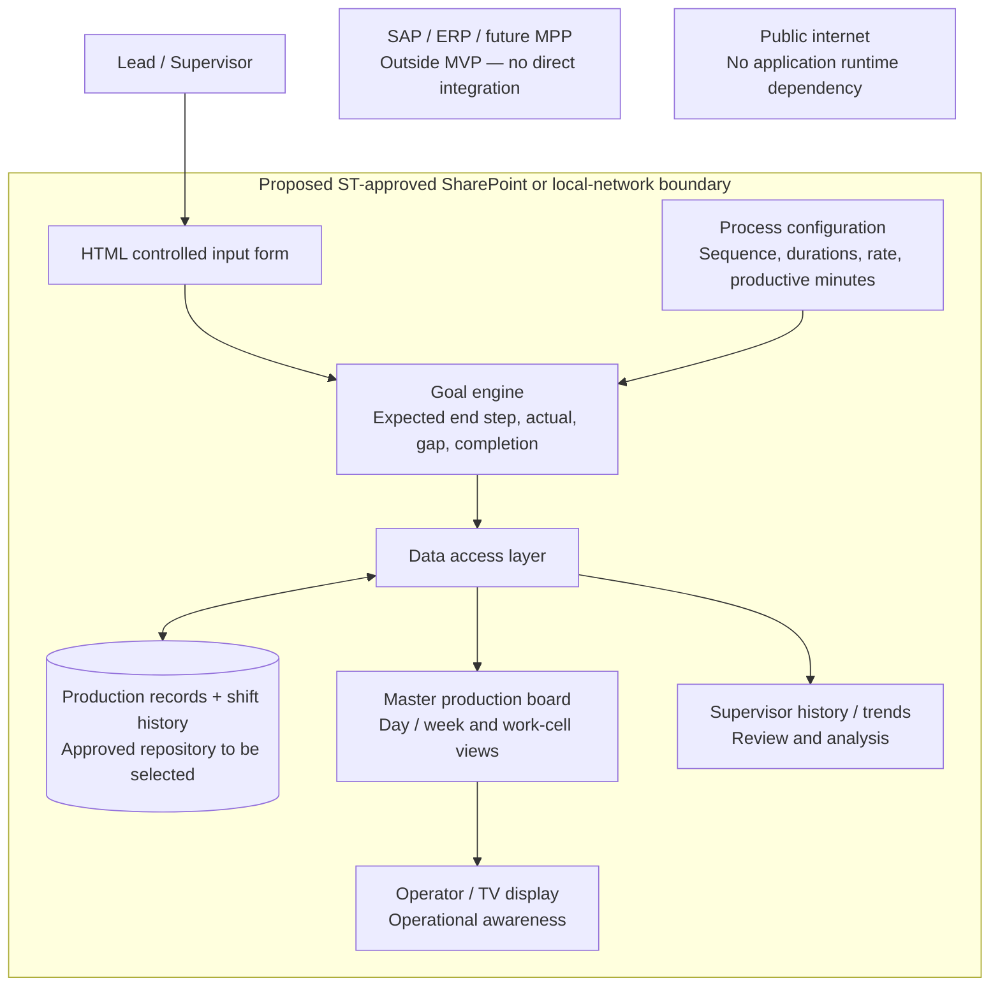

# Current architecture hypothesis — subject to stakeholder validation

This is a working demonstration of the application's modules and information flow. It does not claim that ST has approved a deployment environment, security controls, time standards, or workforce reporting rules.

## Four modules and their current implementation

| Module | Current implementation | Validation or future work |
| --- | --- | --- |
| Data input | Controlled forms; required fields; integer/range checks; duplicate assignment checks; productive time and overtime | Approved names, workspaces, shift conventions, and permitted operator visibility |
| Goal engine | `dist/engine.js`, a pure calculation module driven by configurable timing sequences | Approved step standards, TAC definition, breaks, partial work, parallel operations, rework, and final acceptance |
| Production board | HTML/CSS/JS supervisor day/week board and a paged TV table; actual vs goal and labeled colors | TV resolution/distance, secure floor device, real role permissions |
| History / analytics | `dist/storage.js` device-local adapter; update snapshots; CSV; process/work-cell views and daily goal attainment | Shared storage, identity, concurrency, append-only audit controls, backups, retention, and network deployment |

The interactive **Architecture** page mirrors these modules and makes implemented behavior distinguishable from proposed infrastructure.

## Goal calculation

All timings are explicitly fictional until approved standards are supplied.

1. `start` is the count/index of the last fully completed step, from 0 to the sequence length.
2. Available productive minutes = planned productive minutes + extra productive minutes from overtime. Breaks are excluded from those inputs.
3. Starting with the next step, consume `expected duration / rate multiplier` in sequence.
4. Count a step only when its whole duration fits in the remaining budget. Stop at the first step that does not fit.
5. The last step counted is the calculated goal. It cannot exceed the sequence length. With insufficient time, the goal can equal the start step.
6. Gap = actual end step − calculated goal.
7. Completion = actual end step / total steps. Target completion = goal / total steps. Neither estimates labor efficiency; steps may have unequal durations.
8. A unit counts as complete in the demo when actual end equals the final configured step. This is a hypothesis, not a quality-acceptance decision.

Example using a sequence whose next durations are 60, 45, and 60 minutes: start 2 + 105 productive minutes gives goal 4. Adding 60 minutes of overtime gives goal 5. Actual end 4 then has a gap of −1.

A timing rate of 1 uses standard durations. A rate of 2 halves the duration per step. The demo does not infer personal performance or adjust rates by employee.

## Status semantics

- **Goal met:** actual end is at or above a goal that planned additional steps.
- **In progress:** the shift is still open and there is no reported delay. Being below an end-of-shift target during an active shift does not by itself prove lateness.
- **At risk / Blocked:** explicitly reported on the input form.
- **Below target:** the shift is marked finished and its final actual end is below its goal.
- **No full step planned:** the budget could not accommodate another full step. These assignments are excluded from the goals-met denominator.

The goal outcome takes display priority once the goal is reached; the reported status is still retained in the saved record. This priority is another stakeholder decision to validate.

## Data model

Production assignments contain an ID, assignment date, shift, operator names, work cell, process ID, job ID, part/assembly, start step, calculated goal, actual end step, total steps, planned productive minutes, overtime minutes, reported status, finished flag, comments, and update timestamp.

Each assignment also retains a process timing snapshot: durations, rate multiplier, and configuration revision. Each history event copies those fields along with the prior end step, the new end step, and target gap. Saving a new process configuration does not recalculate existing assignments or historical records.

Every date/shift assignment is independent. The demo does not automatically roll progress from an earlier assignment into the next shift. Carryover, corrections, and rework should be designed with leads before shared deployment.

## Storage and deployment boundary

The prototype runs from local files or a local HTTP server. All runtime assets are bundled locally. It does not load fonts, libraries, analytics, or data from the internet, and does not call SAP, MPP, SharePoint, or any external API.

For the demonstration, the replaceable storage adapter uses the browser's local storage. It is persistent on that browser/origin when storage is available, but it is neither secure shared enterprise storage nor a tamper-proof audit service. Separate devices do not share data. Same-origin tabs can receive updates through storage events. Concurrent writers are last-write-wins in this demo; conflict handling belongs in the shared version.

The target deployment hypothesis is an ST-approved SharePoint or local-network environment with an approved shared data source. SharePoint/OneDrive, Excel, local files, and an internal service remain candidates, not validated choices. A browser cannot safely be assumed to update a shared Excel workbook just because the file lives on a network share. Write access, authentication, locking, validation, and deployment feasibility require an approved integration design.

No external publication is part of this local demonstration.

## Cross-cutting constraints to validate

- Union/workforce rules: permitted operator data, identity visibility, comparisons, and retention.
- GCC High / FedRAMP: applicability, permitted environment, and approved controls to be established with ST IT. This demo makes no compliance claim.
- Proprietary manufacturing data: use fictional content until an approved internal path is agreed.
- Simplicity: minimal operator/TV display, short supervisor forms, no editable spreadsheet layout.
- Robustness: controlled entries, calculated fields, validation, recoverable errors, and historical snapshots.
- Scalability: process definitions are data; goal calculations and data access are separate modules.

## Decisions needed for an ST pilot

1. Approved step durations, shift productive minutes, overtime rules, and what TAC means in this workflow.
2. Whether work is sequential, partially complete, parallel, or subject to rework; definition of unit completion/acceptance.
3. Allowed operator names/identifiers and whether comparisons must stay at the job/work-cell level.
4. ST-approved host, data source, read/write identity, access boundaries, and device setup.
5. Concurrency, audit retention, backup/recovery, and shift rollover behavior.
6. Actual TV size/resolution and a supervisor usability review.
