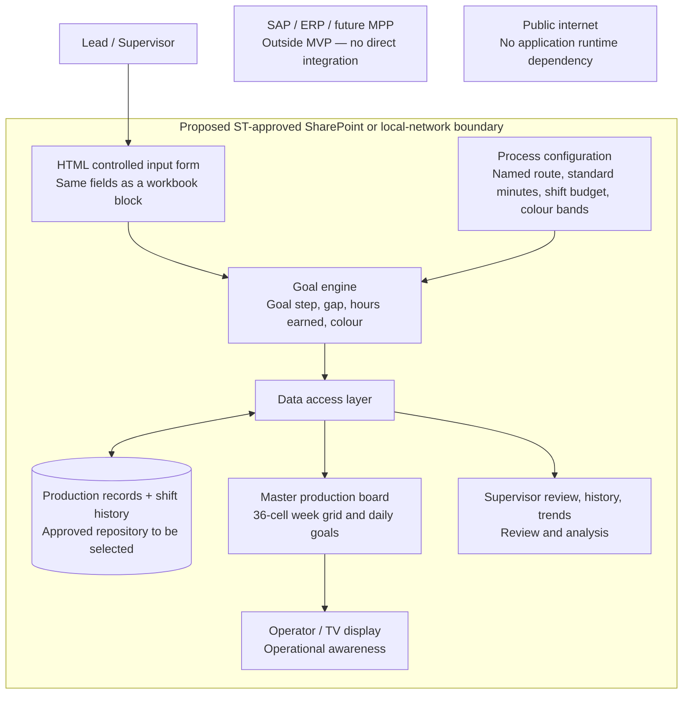

# Current architecture hypothesis — subject to stakeholder validation

This is a working demonstration of the application's modules and information flow. It does not claim that ST has approved a deployment environment, security controls, time standards, or workforce reporting rules.

## Four modules and their current implementation

| Module | Current implementation | Validation or future work |
| --- | --- | --- |
| Data input | Board-shaped form: Name(s), Job #, Hand, Part, Start, Goal (calculated), Stop, Comment. Start and stop are chosen by step name; cell, date, and shift come from the clicked cell; overtime is in hours; duplicate assignments are rejected | The client's simplified intake design, approved names, cell roster, shift conventions, and permitted operator visibility |
| Goal engine | `dist/engine.js`, a pure module: nearest-step and whole-step goal rules, hours earned, colour bands, and completion by standard hours | Approved routes and standards, TAC definition, meaning of purple, breaks, partial work, parallel operations, rework, and final acceptance |
| Production board | HTML/CSS/JS: 36-cell weekly grid with click-to-assign, daily goal cards, paged TV table, and supervisor review | TV resolution and distance, secure floor device, real role permissions |
| History / analytics | `dist/storage.js` device-local adapter; history snapshots with step names, hours, and colour; route revisions; CSV | Shared storage, identity, concurrency, append-only audit controls, backups, retention, and network deployment |

The interactive **Architecture** page mirrors these modules and makes implemented behavior distinguishable from proposed infrastructure.

## Goal calculation

All step names and timings are fictional until approved standard work is supplied.

1. A route is an ordered list of named steps with standard minutes. Zero-minute steps are checkpoints, for example "Notify lead: ready for cure".
2. `start` is stored as the number of steps already complete. The form shows it as the first step worked this shift (**Start**); `end` is the last step completed (**Stop**).
3. Budget = the process's shift budget (8 standard hours by default) + overtime hours × 60. A rate multiplier divides every step duration.
4. **Nearest-step rule** (default; matches the workbook): the goal is the step whose cumulative standard time is closest to start + budget, with ties going to the earlier step. The goal can sit slightly above or below the budget.
5. **Whole-step rule** (v3): the goal is the last step that fits entirely inside the budget.
6. Gap = stop − goal, in steps. Hours earned = standard time from start to stop.
7. Completion = standard hours complete ÷ the route's total standard hours. It reaches 100% only when the final step is recorded.

Example with the sample inner-bondment route: start on step 5, "Peel & prep skin", with an 8-hour budget and the goal is step 13, "3rd debulk". With 1 overtime hour it becomes step 14, "Lay up ply level 6". Stopping at step 13 earns 8.0 standard hours: a gap of −1 and a yellow shift against the 9-hour budget.

A timing rate of 1 uses standard durations; a rate of 2 halves them. The demo does not infer personal performance or adjust rates by employee.

## Shift colours

Finished shifts are coloured by hours earned against their own budget. The defaults reproduce the workbook's conditional formatting on an 8-hour shift:

| Colour | Hours earned on an 8 h shift | Relative to the budget |
| --- | --- | --- |
| Red | below 6.5 | more than 1.5 h below |
| Yellow | 6.5 – 7.5 | 0.5 – 1.5 h below |
| Green | 7.5 – 8.05 | from 0.5 h below to 0.05 h above |
| Purple | 8.05 or more | 0.05 h or more above |

Overtime raises every band by the overtime hours. Open shifts are not coloured, because a partial shift is not evidence of lateness. Training shifts and shifts reported as blocked are never coloured. The workbook leaves 6.49–6.5 h uncoloured; the app treats it as red. The margins are editable per process and saved with each revision.

## Status semantics

- **In progress / At risk / Blocked:** an open shift; at risk and blocked are reported on the form.
- **Goal met:** an open shift that has already reached its goal step.
- **Red / Yellow / Green / Purple:** a finished shift's colour, shown with its hours earned.
- **Training:** never coloured. A finished shift reported as **Blocked** stays blocked and is not coloured.
- **No full step planned:** the budget could not reach another step.
- **Below target:** a finished shift below its goal that has no budget to colour against.

## Supervisor review

The review page counts colours per operator for finished, coloured shifts over 1, 2, or 4 weeks, across all processes, cells, and shifts. A shared shift counts once for each named operator. Operators with repeated purples or reds (2, 3, or 4 or more) are flagged, and every purple shift links to its job history. Averages compare hours earned with each shift's own budget. The page carries no login and says so; the meaning of purple and the permitted comparisons remain stakeholder decisions.

## Data model

Production assignments contain an ID, assignment date, shift, operator names, work cell, process ID, job ID, part (the route name), hand (LH/RH), start, goal, stop, total steps, shift budget, overtime minutes, goal rule, reported status, finished and training flags, comments, previous-assignment link, and update timestamp.

Each assignment keeps its step timings and route revision. Every saved process revision is stored with its step names, timings, budget, goal rule, and colour bands, so renaming steps, importing a route, or restoring the standard route never renames or recalculates older records. Each history event copies the assignment together with its start, stop, and goal step names, hours earned, and colour.

Every date/shift assignment has its own ID and operator record. Next shift creates a new assignment linked by previousAssignmentId, prefilled from the prior stop. Prior assignments are retained. Production-day order provisionally follows the workbook: 3 → 1 → 2, then the next date. Earlier corrections do not automatically rewrite downstream assignments.

The weekly assembly view selects the latest assignment per process/job through the chosen day, before grouping by cell. Multiple shifts do not inflate assembly totals. A unit stays in its last-recorded cell until a later assignment moves it, and leaves the grid after the day it reaches its final step; this is not verified live occupancy. Days after today show as upcoming. Cell 01–36 are placeholders. A job number is provisionally one unit within a process.

Overtime entry is in hours, storage stays in minutes, and the shift budget lives in process configuration. A handoff keeps the unit's route revision and takes the current default shift budget.

## Storage and deployment boundary

The prototype runs from local files or a local HTTP server. All runtime assets are bundled locally. It does not load fonts, libraries, analytics, or data from the internet, and does not call SAP, MPP, SharePoint, or any external API.

For the demonstration, the replaceable storage adapter uses the browser's local storage under `quest-board-demo-v4`. It is persistent on that browser/origin when storage is available, but it is neither secure shared enterprise storage nor a tamper-proof audit service. Separate devices do not share data. Same-origin tabs receive updates through storage events. Concurrent writers are last-write-wins in this demo. Local edits from v3 remain in the browser under the old key and are not loaded.

The target deployment hypothesis is an ST-approved SharePoint or local-network environment with an approved shared data source. SharePoint/OneDrive, Excel, local files, and an internal service remain candidates, not validated choices. A browser cannot safely be assumed to update a shared Excel workbook just because the file lives on a network share. Write access, authentication, locking, validation, and deployment feasibility require an approved integration design.

No external publication is part of this local demonstration.

## Cross-cutting constraints to validate

- Union/workforce rules: permitted operator data, identity visibility, comparisons, and retention.
- GCC High / FedRAMP: applicability, permitted environment, and approved controls to be established with ST IT. This demo makes no compliance claim.
- Proprietary manufacturing data: fictional routes until an approved internal path is agreed. A pasted route stays in the local browser.
- Simplicity: the entry form matches the workbook block; minimal operator/TV display; no editable spreadsheet layout.
- Robustness: dropdowns instead of free text, calculated fields, validation, recoverable errors, and historical snapshots.
- Scalability: routes are data; goal calculations and data access are separate modules.

## Decisions needed for an ST pilot

1. Approved routes (step names and standard minutes) for each part, the shift budget, overtime rules, and what TAC means in this workflow.
2. The goal rule (keep the workbook's nearest-step lookup or use whole steps) and the Start convention; see `MEETING FOLLOW-UP.md`.
3. What purple means, whether repeats should be flagged, and which operator comparisons are permitted.
4. Whether work is sequential, partially complete, parallel, or subject to rework; the definition of unit completion and acceptance.
5. ST-approved host, data source, read/write identity, access boundaries, and device setup.
6. Concurrency, audit retention, backup/recovery, and shift rollover behavior.
7. Actual TV size/resolution and a supervisor usability review.

## Meeting and workbook reconciliation

See `MEETING FOLLOW-UP.md` for the 9/28 feedback, the reviewed workbook ranges, and the open decisions. The app has no automatic quality judgements, rankings by score, or enforced supervisor access; flags are prompts for review.
